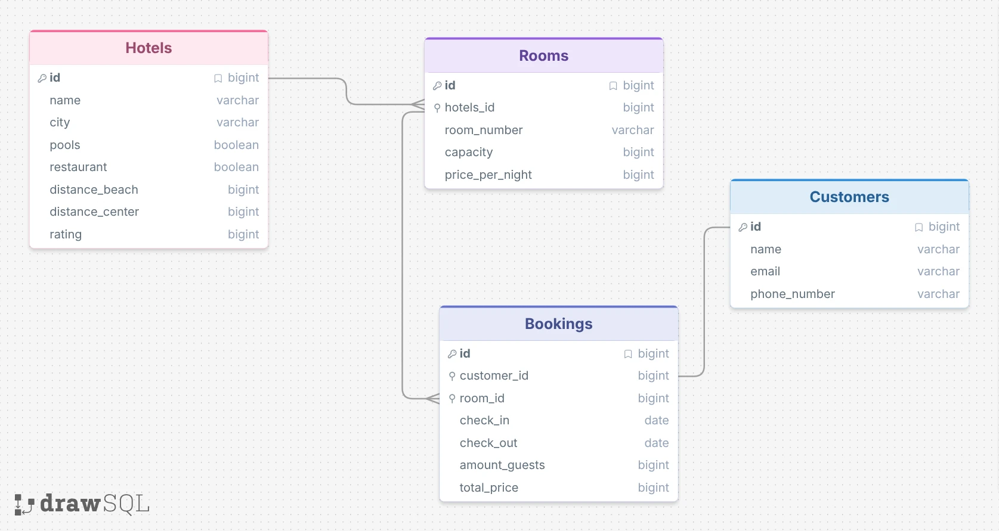

## ER-diagrammet 
Diagramet ritade vi tillsammans i gruppen i början, men när jag byggde min egen databas i MySQL gjorde jag några mindre ändringar. Jag bytte namn på kolumnerna "pools" till "pool" och "hotels_id" till "hotel_id", och ändrade datatyperna från "bigint" till "INT" och "DECIMAL" för pris och rating. Jag kopplade också "customer_id" i "Bookings" som främmande nyckel till "id" i "Customers". 

## Testdokumentation
Jag testade programmet manuellt i konsolen mot min MySQL-databas för att se att allt fungerar som det ska. När jag sökte efter rum i "Malmö" mellan "2026-12-01" och "2026-12-04" filtrerades det redan bokade rummet "101" bort medan de lediga rummen visades. Jag testade också att boka ett rum samma dag som en tidigare gäst checkade ut, vilket fungerade eftersom utcheckningsdagen inte räknas som upptagen, medan överlappande datum nekades.

Jag provade även att boka ett rum för 1 person med 3 gäster och det stoppades direkt. Dessutom testade jag att kombinera filtren för "pool", "restaurant" och maxavstånd till strand och centrum samt sortering på både pris och betyg. Slutligen kontrollerade jag att ändring av antal gäster följer rummets maxkapacitet, att ett avbokat rum blir ledigt igen och att alla ändringar och bokningar finns kvar i databasen när man startar om programmet.

